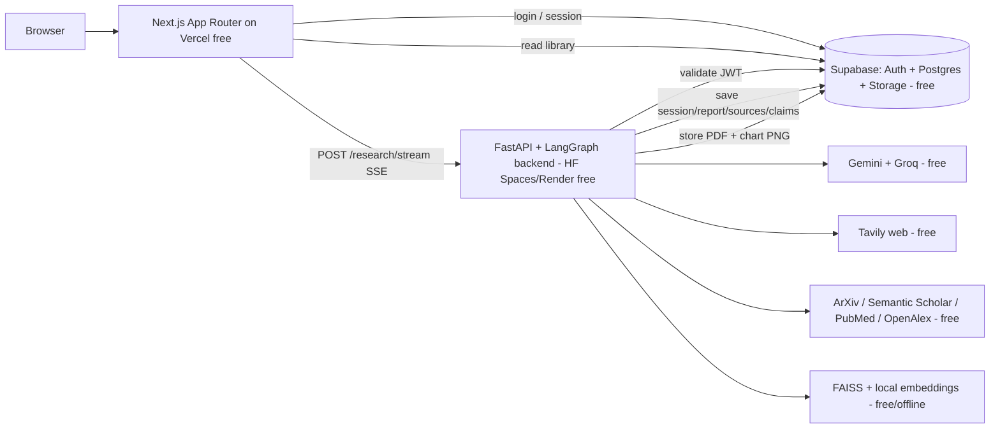

# Best-of-Best Research System — Upgrade Plan (100% Free Stack)

**Goal:** take the existing multi-agent research backend (Phases 0–7, already built and tested)
and elevate the *whole product* — UI, UX, frontend, backend, database, auth, deployment — to a
best-in-class level, using **only free, no–credit-card services**.

**Locked decisions (from our kickoff):**

| Area | Decision |
|---|---|
| UI/UX | **Perplexity-style conversational** experience |
| Frontend stack | **Next.js (App Router) + Tailwind + shadcn/ui + Framer Motion** |
| Accounts | **User accounts + saved, searchable research library** |
| Hosting | **Runs locally now, structured to deploy to free hosting later** |
| Cost | **Everything free; prefer services that need no credit card** |

---

## 1. What "best of best (free)" means here

We are not building a Perplexity clone — the engine you already have is *more* capable than a
plain web-answer bot. The plan leans into five genuine differentiators and makes them shine in
the UI:

1. **Transparent multi-agent pipeline** — the user watches Plan → Search → Papers → Fact-check →
   Write → Review happen live, instead of a black-box spinner.
2. **Web + academic sources together** — Tavily web results *and* ArXiv / Semantic Scholar
   papers, side by side.
3. **Explicit fact-checking** — per-claim confidence and, crucially, **surfaced contradictions**
   ("sources disagree") rather than a confident single answer.
4. **Real citations + export** — numbered, APA/MLA, resolving to the right source, with clean
   PDF export.
5. **A saved research library** — every report kept, searchable, re-openable, re-exportable.

The quality bar for every layer: fast, accessible (WCAG AA), responsive, dark/light, animated
but calm, and resilient on free-tier limits.

---

## 2. Target architecture

**Division of labor**

- **Next.js on Vercel** — the whole UI, auth session handling, and reading the library directly
  from Supabase. Vercel's free functions are too short-lived for the long research run, so they
  only proxy/kick off; the heavy work lives on the Python backend.
- **FastAPI + LangGraph** (your current `app/`) — the research pipeline, unchanged in spirit,
  extended with auth, persistence, multi-user safety, and more free sources.
- **Supabase** — one free service that gives us Auth + Postgres + file Storage, no credit card.

---

## 3. The free stack (every layer, with limits + why)

| Layer | Choice (free) | Why / free-tier note | No card? |
|---|---|---|---|
| Frontend host | **Vercel** | First-class Next.js host, generous free tier | ✅ |
| Frontend | **Next.js 14 App Router + React 18** | SSR/routing/SEO, easy Vercel deploy | ✅ |
| Styling/components | **Tailwind CSS + shadcn/ui** | Best-in-class accessible components you own | ✅ |
| Motion | **Framer Motion** | Smooth streaming/transition animations | ✅ |
| Charts (UI) | **Recharts** | Crisp, interactive charts from your `ChartSpec` | ✅ |
| Backend | **FastAPI + LangGraph** (existing) | Keep the strong engine you built | ✅ |
| Backend host | **Hugging Face Spaces (Docker)** *(primary)* / Render *(alt)* | HF Spaces is built for Python/ML, free, no card; Render is fine but sleeps + cold-starts | ✅ |
| Auth | **Supabase Auth** | Email magic-link + Google OAuth, free | ✅ |
| Database | **Supabase Postgres** (500 MB free) / Neon (alt) | Real Postgres for the library; RLS for per-user isolation | ✅ |
| File storage | **Supabase Storage** (1 GB free) | PDFs + chart PNGs | ✅ |
| LLMs | **Gemini + Groq** (both free) | Multi-model: Gemini for reasoning, Groq (Llama) for fast/cheap stages | ✅ |
| Web search | **Tavily** (1k credits/mo free) | Already integrated | ✅ |
| Papers | **ArXiv, Semantic Scholar** (have) **+ PubMed/Europe PMC, OpenAlex, Crossref** (add) | All free; PubMed especially strong for the health questions in your test set | ✅ |
| Embeddings/vectors | **HuggingFace local models + FAISS** (existing) | Free, offline after first download | ✅ |
| Cache/queue *(optional)* | **Upstash Redis** (free) or keep SQLite | For deploy-time cache + job status | ✅ |
| CI/CD | **GitHub Actions** (free) | Tests, lint, build on every push | ✅ |
| Error monitoring | **Sentry** (free) | Frontend + backend error tracking | ✅ |
| Keep-warm | **cron-job.org / UptimeRobot** (free) | Ping backend to dodge cold starts | ✅ |

**The whole stack can be assembled with zero credit cards** — that's a deliberate constraint,
matching your "free only" rule.

---

## 4. UI/UX plan — the Perplexity-style experience

**Core loop:** big ask box → answer streams in with live pipeline steps → inline citations →
sources & papers expand below → follow-up chips → save/export.

**Screens & states**

- **Home / empty state:** centered hero ask box, a few example questions, recent-from-library
  peek. Calm, focused.
- **Answer view:** the ask box docks to the top; below it the answer streams token-by-token.
  - **Live agent tracker** (uses your existing SSE stage events): an animated stepper
    *Plan → Search → Papers → Verify → Write → Review*, each ticking to ✓ as it completes, with
    human-readable sub-labels ("Reading 7 sources…"). This is the signature moment.
  - **Inline citations `[1] [2]`** are clickable; hovering shows a source hover-card; clicking
    scrolls to / highlights the source.
  - **Confidence & contradiction badges** on claims — e.g. a subtle "⚠ Sources disagree" chip
    that expands to show the conflicting sources. This is our standout vs. Perplexity.
  - **Sources panel:** cards below the answer, tabbed **Web / Papers**. Web cards show
    favicon+title+snippet+domain; paper cards show title+authors+year+venue+abstract peek + link.
  - **Charts:** rendered inline and interactively with Recharts from your `ChartSpec` (keep
    matplotlib only for the PDF).
  - **Follow-up chips:** clickable suggested next questions that start a new run.
  - **Actions row:** Copy markdown · Download PDF · Share link · Save to library (auto-saved once
    logged in).
- **Library / history:** left sidebar + main list. Search, folders/tags, star favorites, rename,
  delete, re-open a past report, re-export. Resume a report exactly as it was.
- **Auth:** clean login/signup (magic link + Google), profile menu, settings (theme, default
  export format).

**UX excellence details (the "best of best" layer)**

- **⌘K command palette** — new research, jump to any past report, toggle theme.
- **Dark / light / system** theme with proper design tokens.
- **Skeleton loaders, optimistic UI, toasts**, graceful empty & error states (your backend
  already degrades gracefully — the UI will honor that with a "partial result" banner instead of
  a dead spinner).
- **Full accessibility:** semantic HTML, keyboard nav, focus rings, `prefers-reduced-motion`
  respected, AA contrast, screen-reader labels.
- **Mobile-first responsive** — the multi-panel content reflows to stacked cards on phones.
- **Perceived speed:** stream everything; never block on the whole pipeline.

---

## 5. Frontend build plan (Next.js)

- **App Router structure:** `app/(marketing)/page.tsx` home, `app/research/[id]/page.tsx`
  answer view, `app/library/page.tsx`, `app/login`, plus a `components/` design-system folder.
- **shadcn/ui** for buttons, dialogs, tabs, hover-cards, command palette, toasts, dropdowns —
  themed with your tokens.
- **Streaming:** consume the existing `/research/stream` SSE endpoint with `EventSource` /
  `fetch`-stream; a small state machine maps stage events → the live tracker and appends answer
  tokens.
- **State:** React Server Components for library reads; light client state (Zustand or React
  context) for the active research session. TanStack Query for Supabase reads/caching.
- **Auth integration:** `@supabase/ssr` for session in Next.js; attach the Supabase JWT to
  backend requests.
- **Testing:** Vitest + Testing Library (unit), Playwright (E2E), axe + Lighthouse (a11y/perf).

---

## 6. Backend plan (extend, don't rewrite)

Keep FastAPI + LangGraph + FAISS. Add:

- **Auth:** middleware that validates the Supabase JWT and extracts `user_id`; endpoints become
  user-aware.
- **Persistence:** after (and during) a run, save session → report → sources → claims → charts to
  Postgres, and push the PDF + chart PNGs to Supabase Storage. This is what turns a one-off run
  into the saved library.
- **Multi-user safety:** the README notes it currently assumes one session at a time. Add
  per-request state isolation, a DB-backed job/status record, and async concurrency so two people
  (or two tabs) can run at once on a single free instance.
- **More free sources:** add PubMed/Europe PMC (health), OpenAlex + Crossref (broad scholarly),
  Wikipedia (grounding) — all free, all fitting your existing retrieval-agent + cache pattern.
- **Multi-model:** finally use the already-wired **Groq** (fast, free Llama) for lighter stages
  (e.g. fact-check extraction, chart detection) and keep **Gemini** for the heavy reasoning —
  this relieves Gemini quota *and* speeds up runs.
- **Security hardening:** tighten CORS from `*` to your known origins, per-user rate limiting to
  respect free API quotas, strict input validation, secrets via env only.

---

## 7. Database plan (Supabase Postgres)

Migrate the existing SQLAlchemy `db/` layer from SQLite to Postgres (SQLAlchemy supports both;
add **Alembic** migrations). Proposed schema (all rows scoped by `user_id`, protected by
**Row-Level Security**):

| Table | Key columns |
|---|---|
| `research_sessions` | id, user_id, question, status, created_at, folder_id, starred |
| `reports` | id, session_id, markdown, pdf_url, apa/mla refs, created_at |
| `sources` | id, session_id, kind (web/paper), title, url, authors, year, venue, snippet, citation_no |
| `claims` | id, session_id, sub_question, verdict, confidence, contradicted (bool) |
| `charts` | id, session_id, spec_json, png_url |
| `follow_ups` | id, session_id, question |
| `folders` / `tags` | id, user_id, name (for organizing the library) |

**Local vs. deploy:** use the free Supabase cloud project even during local dev (simplest), or
run the full Supabase stack locally via the Supabase CLI (Docker) for offline work. Everything is
driven by `DATABASE_URL` / `SUPABASE_URL` env vars, so local↔deploy is a config flip, not a
rewrite. Your existing SQLite retrieval cache can stay local, or move to Upstash Redis for
deploy.

---

## 8. Deployment plan (deploy-ready, flip later)

- **Local now:** `docker-compose` (or two terminals) for backend + frontend; `.env.example`
  extended with Supabase keys; connect to the free Supabase project.
- **When you deploy:**
  - Frontend → **Vercel** (connect the repo, set env, done).
  - Backend → **Hugging Face Spaces (Docker)** primary, or **Render**; add a free keep-warm ping
    to dodge cold starts.
  - DB/Auth/Storage → **Supabase** (already cloud).
  - **GitHub Actions** runs your 153 tests + lint + frontend build on every push.
  - **Sentry** free for error monitoring.
- **Design for it up front:** 12-factor config (env-driven), container-ready, no hard-coded URLs,
  CORS locked to known origins.

---

## 9. Phased roadmap (continues your Phase 0–7)

Each phase is independently shippable — you always have a working app.

| Phase | Title | Outcome |
|---|---|---|
| **8** | **Next.js foundation + design system** | Migrate frontend to Next.js + Tailwind + shadcn/ui + theming + motion; **reach feature parity** with today's ask→stream→report first |
| **9** | **Perplexity-style research experience** | Live agent tracker, clickable citations + hover cards, web/paper source cards, interactive Recharts, contradiction/confidence badges, follow-ups, export, ⌘K, a11y + responsive |
| **10** | **Auth & accounts** | Supabase Auth (magic link + Google), Next.js sessions, profile menu, protected routes |
| **11** | **Persistence & library** | Postgres schema + Alembic + RLS, save every run, Supabase Storage for PDFs/charts, library UI (search/folders/tags/star/re-export/resume) |
| **12** | **Backend hardening + richer research** | JWT validation, per-user quotas, safe concurrency, add PubMed/OpenAlex/Crossref/Wikipedia, activate Groq multi-model, tighten security |
| **13** | **Free deploy + CI/CD** | Dockerize, deploy FE→Vercel / BE→HF Spaces, env/secrets, keep-warm, GitHub Actions, Sentry |
| **14** | **QA, accessibility, polish** | Vitest + Playwright + axe/Lighthouse passes, free-tier load sanity check, docs |

**Suggested first step:** Phase 8 (parity on the new stack) — lowest risk, unblocks all the UI
work, and you immediately *see* the upgrade.

---

## 10. Risks & free-tier gotchas (with mitigations)

- **Cold starts** (Render/HF free instances sleep) → keep-warm cron + a friendly "waking up the
  research engine…" state.
- **API quotas** (Tavily 1k/mo, Gemini free limits) → your existing cache + retry, per-user rate
  limits, and Groq offloading; show remaining-quota awareness.
- **Cache persistence on ephemeral hosts** (SQLite resets on redeploy) → move cache to Upstash
  Redis or Supabase for deploy; fine as-is locally.
- **Concurrency** (currently single-session) → Phase 12 adds per-request isolation + DB-backed
  job status.
- **Vercel function time limits** → never run the pipeline on Vercel; it lives on the Python host
  and streams via SSE.

---

## 11. A few choices I've defaulted for you (say the word to change)

I picked sensible defaults so we're not blocked — tell me if you'd prefer otherwise:

1. **Auth + DB + Storage → Supabase** (one free service, no card, bundles all three) rather than
   Neon + separate Auth.js. *Recommended.*
2. **Backend host → Hugging Face Spaces (Docker)** as primary free target (best for Python/ML, no
   card), Render as the fallback.
3. **First extra sources → PubMed/Europe PMC + OpenAlex** (biggest quality jump, esp. for
   science/health), others after.
4. **Charts → interactive Recharts in the UI**, keep matplotlib only for the PDF.
5. **Activate Groq** for light stages to save Gemini quota and speed up runs.

---

## 12. What I need from you to start building

Nothing blocking — but when you're ready to build (you said no code yet), the only real
prerequisites are free signups: a **Supabase** project (URL + anon key + JWT secret), and
confirming your existing **Gemini / Tavily** keys. I'll wire everything to `.env` so no secret is
ever hard-coded.

Say **"start Phase 8"** (or pick any phase) and I'll turn that phase into a concrete task list and
begin.
