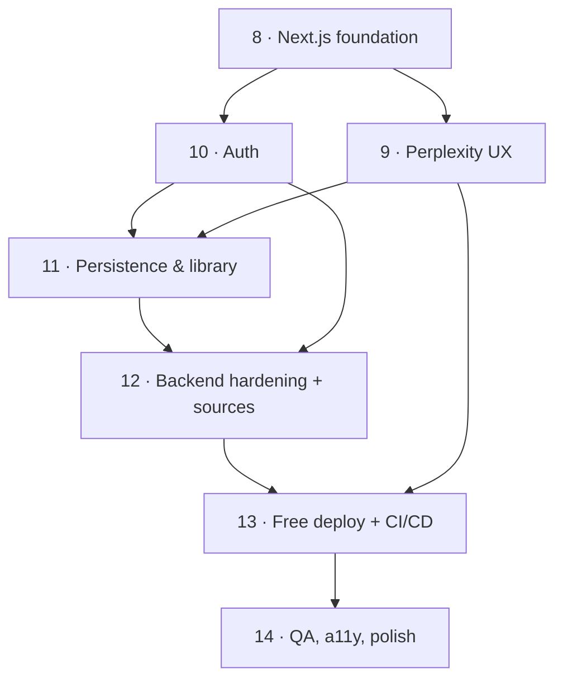

# Build Phases — Research System Upgrade

This is the **execution checklist** for the upgrade described in `BEST_OF_BEST_PLAN.md`.
It continues the repo's existing numbering (Phases 0–7 are already done). Every phase is
independently shippable — the app keeps working after each one.

**How each phase runs:** when you say *"start Phase N"*, I turn that phase's tasks into a live
task list, build it, run/extend tests, and only mark it done when its **Definition of Done** is
fully met. No phase silently touches another phase's scope.

**Visual identity:** the palette, typography, layout, and the "Emerald Horizon" animated background
are specified in `DESIGN.md`; Phases 8–9 implement it (v1 static/ambient in 8, reactive in 9).

Legend — **Touches:** FE = frontend · BE = backend · DB = database/storage · Ops = deploy/CI ·
**Size:** S / M / L (relative effort).

## Overview & sequence

| Phase | Title | Touches | Size |
|---|---|---|---|
| 8 | Next.js foundation + design system (parity first) + Emerald Horizon bg v1 | FE (+tiny BE CORS) | M |
| 9 | Perplexity-style research experience | FE (+small BE payload shaping) | L |
| 10 | Auth & accounts (Supabase) | FE + BE + DB | M |
| 11 | Persistence & saved library | BE + DB + FE | L |
| 12 | Backend hardening + richer research | BE (+ small FE) | L |
| 13 | Free deploy + CI/CD | Ops (FE + BE + DB config) | M |
| 14 | QA, accessibility, polish | FE + BE | M |

Critical path: **8 → 10 → 11 → 12 → 13 → 14**. Phase 9 (the UX) runs right after 8 and only needs
to be *finished* before deploy (13). Phases 9 and 10 can be built in either order after 8.

---

## Phase 8 — Next.js foundation + design system (parity first)

**Goal:** stand up the new Next.js frontend with the design system and **reproduce today's
functionality** (ask → SSE stream → markdown report → PDF download). No new features yet — prove
parity, de-risk the migration.

**Depends on:** existing backend running locally. **Touches:** FE (+ tiny BE CORS). **Size:** M.

**Prerequisites:** Node 18+; existing Gemini + Tavily keys working.

**Build tasks**

- [ ] Scaffold Next.js 14 (App Router, TypeScript, ESLint) — replace the Vite app in `frontend/`.
- [ ] Configure Tailwind + design tokens from `DESIGN.md` (Emerald Horizon palette:
      Abyss / Viridian / Horizon-Glow / Champagne, spacing, radius, type scale).
- [ ] Install shadcn/ui + base components: button, input, card, tabs, dialog, dropdown, toast,
      skeleton, hover-card, command.
- [ ] Add Framer Motion and `next/font` — load the `DESIGN.md` typefaces: **Fraunces** (display),
      **Geist Sans** (UI), **Newsreader** (report body), **Geist Mono** (citations/labels).
- [ ] Theme provider: dark / light / system with tokens; header + theme toggle; app shell/layout.
- [ ] **Emerald Horizon background — v1:** static emerald gradient + a lazy-loaded ambient Three.js
      r128 particle-horizon canvas, with `prefers-reduced-motion` / no-WebGL static fallback, DPR
      cap, and pause-when-hidden/offscreen. Ship the calm, non-reactive version first (see `DESIGN.md`).
- [ ] Markdown rendering pipeline (react-markdown + remark-gfm) with themed typography.
- [ ] Backend API client + **SSE stream reader** that maps events → UI state.
- [ ] Research page: ask box → `/research/stream` → streaming markdown answer → basic loading.
- [ ] PDF download wired to existing `/research/pdf`.
- [ ] Backend: add `http://localhost:3000` to CORS origins (small, isolated change).

**Definition of Done**

- [ ] `npm run dev` serves the Next app; asking a question streams a report **identical in
      content** to the old Vite frontend; PDF downloads.
- [ ] Dark/light works; layout is responsive on mobile; no console errors.
- [ ] Old Vite frontend archived/removed.

**Tests:** Vitest + Testing Library smoke tests (ask box, markdown renderer); documented manual
parity check against the old UI.

---

## Phase 9 — Perplexity-style research experience

**Goal:** turn the parity UI into the signature Perplexity-style experience with all five
differentiators.

**Depends on:** Phase 8. **Touches:** FE (+ small BE payload shaping). **Size:** L.

**Build tasks**

- [ ] Verify/shape the backend payload so the frontend gets **structured** sources, claims
      (verdict / confidence / `contradicted`), and chart specs — inspect `stream_events.py` +
      `schemas.py`; add fields if missing (small BE change).
- [ ] Home / empty state: hero ask box + example questions + recent-from-library peek (stub until 11).
- [ ] Answer view: ask box docks to top; answer streams below.
- [ ] **Live agent-step tracker** from SSE stage events (Plan → Search → Papers → Verify → Write →
      Review), animated, with human-readable sub-labels.
- [ ] **Emerald Horizon background — v2 (reactive):** couple the field to the SSE pipeline — diffuse
      flow when idle, converge/energize while agents run, settle when the report is ready — synced
      with the tracker. Add glass reading panels + Champagne citation accents; final motion tuning
      (see `DESIGN.md`).
- [ ] Inline `[N]` citations: custom markdown renderer mapping to source objects → hover-card +
      click-to-scroll/highlight.
- [ ] Sources panel: tabbed **Web / Papers** with distinct card designs (favicon/title/snippet vs.
      authors/year/venue/abstract).
- [ ] **Confidence + contradiction badges** on claims ("⚠ Sources disagree" → expands to show
      conflicting sources).
- [ ] Interactive charts via **Recharts** from `ChartSpec` (graceful fallback to PNG).
- [ ] Follow-up suggestion chips (start a new run).
- [ ] Actions row: copy markdown · download PDF · share (local link) · save-to-library (stub → 11).
- [ ] **⌘K command palette** (new research, toggle theme).
- [ ] Skeleton loaders, toasts, and empty / error / **partial-result** states (honor the backend's
      graceful degradation).
- [ ] Full responsive + accessibility pass (keyboard nav, focus rings, `prefers-reduced-motion`,
      AA contrast, screen-reader labels).

**Definition of Done**

- [ ] A real run shows the live tracker, streams the answer with clickable citations, displays web
      + paper cards, shows a confidence/contradiction badge on an appropriate question, renders an
      interactive chart when data supports it, and offers follow-ups.
- [ ] Fully keyboard-navigable; Lighthouse accessibility ≥ 95.

**Tests:** unit tests for citation parsing, chart adapter, tracker reducer; Playwright E2E over a
mocked research run.

---

## Phase 10 — Auth & accounts (Supabase)

**Goal:** users can sign up / log in; the app and backend know who they are.

**Depends on:** Phase 8. **Touches:** FE + BE + DB. **Size:** M.

**Prerequisites:** create the free **Supabase** project → collect URL, anon key, service-role key,
JWT secret; configure Google OAuth credentials (free).

**Build tasks**

- [ ] Enable Supabase Auth: email magic-link + Google OAuth; set redirect URLs.
- [ ] Next.js session handling via `@supabase/ssr`; middleware for protected routes.
- [ ] Login / signup UI, profile menu, sign-out; minimal settings (default theme, default export).
- [ ] Backend: JWT validation middleware (verify against Supabase JWT secret / JWKS), extract
      `user_id`; decide anonymous "try it" vs. login-required (default: allow anonymous run, require
      login to save).
- [ ] Frontend attaches the Supabase access token to backend `/research` calls.

**Definition of Done**

- [ ] A new user can sign up via magic link **and** Google, see their profile, and sign out.
- [ ] Backend correctly identifies the user on requests; protected routes redirect when logged out;
      tampered/expired tokens are rejected.

**Tests:** backend JWT validation units (valid / expired / tampered); E2E login flow (mocked
provider).

---

## Phase 11 — Persistence & saved library

**Goal:** every research run is saved and browsable.

**Depends on:** Phase 10 (and Phase 9 for the UI surfaces). **Touches:** BE + DB + FE. **Size:** L.

**Build tasks**

- [ ] Define Postgres schema via SQLAlchemy + **Alembic** migrations: `research_sessions`,
      `reports`, `sources`, `claims`, `charts`, `follow_ups`, `folders`, `tags` (all `user_id`-scoped).
- [ ] Migrate the existing `db/` layer from SQLite → Postgres via `DATABASE_URL` (keep the
      retrieval cache local for now; deploy-time cache handled in Phase 12/13).
- [ ] **Row-Level Security** policies so users see only their own rows.
- [ ] Supabase **Storage** buckets for PDFs + chart PNGs; signed URLs.
- [ ] Backend persists session/report/sources/claims/charts during/after a run; uploads PDF + chart
      images; returns IDs/URLs.
- [ ] Auto-save on completion when logged in; wire the Phase 9 "save-to-library" button.
- [ ] Library UI: sidebar list, search, folders/tags, star, rename, delete.
- [ ] `/research/[id]` loads a saved session from DB and renders it **exactly** like a fresh run
      (report, sources, charts, citations); re-export PDF.

**Definition of Done**

- [ ] Completing a run while logged in creates a library entry; reopening it reproduces the full
      report, sources, charts, and resolvable citations.
- [ ] Search / star / folder / rename / delete all work.
- [ ] **RLS verified:** a second user cannot see or open the first user's reports.

**Tests:** model + migration tests; RLS policy tests; E2E run → appears in library → reopen →
matches.

---

## Phase 12 — Backend hardening + richer research

**Goal:** make it safe for multiple users and richer in sources and models.

**Depends on:** Phases 10 & 11. **Touches:** BE (+ small FE for quota messaging). **Size:** L.

**Build tasks**

- [ ] **Concurrency:** audit the graph for shared mutable state; ensure per-request isolation +
      async concurrency; add a DB-backed job/session status record so two runs don't interfere.
- [ ] **Per-user rate limiting / quotas** respecting free API limits; friendly quota messaging in
      the UI.
- [ ] New **free** sources as cached+retried retrieval agents (existing pattern) and wired into the
      graph + citations: PubMed/Europe PMC, OpenAlex, Crossref, Wikipedia.
- [ ] **Multi-model:** activate the already-wired **Groq** for light stages (fact-check extraction,
      chart detection); keep Gemini for heavy reasoning; config-driven model routing with fallback.
- [ ] **Security:** lock CORS to known origins (remove `*`), strict input validation, security
      headers, secret hygiene.
- [ ] Deploy-ready **cache** option: back retrieval cache with Upstash Redis or Postgres
      (env-driven), since host filesystems are ephemeral.

**Definition of Done**

- [ ] Two simultaneous `/research/stream` runs complete correctly and independently.
- [ ] New sources appear in results and resolve as citations; Groq handles its stages with Gemini
      fallback.
- [ ] CORS rejects unknown origins; rate limiting returns clear, user-friendly errors.

**Tests:** parallel-run concurrency test; new-source agent tests (cache-hit + retry + fallback);
model-routing tests; CORS/security tests — extending the existing 153-test suite.

---

## Phase 13 — Free deploy + CI/CD

**Goal:** live on the internet, free, with automated checks.

**Depends on:** Phases 8–12 (subsets can deploy earlier). **Touches:** Ops + FE/BE/DB config.
**Size:** M.

**Prerequisites:** GitHub repo; Hugging Face + Vercel accounts (free, no card).

**Build tasks**

- [ ] Dockerfile for the backend; deploy to **Hugging Face Spaces (Docker)** [primary] or Render.
- [ ] Deploy frontend to **Vercel**; wire production env; point at production Supabase.
- [ ] Production config: CORS → Vercel domain, Supabase redirect URLs, all secrets via env.
- [ ] **Keep-warm** cron (cron-job.org / UptimeRobot) to dodge backend cold starts.
- [ ] **GitHub Actions:** run `pytest` + frontend lint/build/tests on PRs; optional auto-deploy on
      `main`.
- [ ] **Sentry** (free) for frontend + backend error monitoring.
- [ ] Deploy runbook in docs.

**Definition of Done**

- [ ] Public URL works end-to-end (login → run → save → reopen → export).
- [ ] CI passes on a PR; errors surface in Sentry; cold-start is mitigated.

**Tests:** green CI pipeline; smoke test against the deployed URL.

---

## Phase 14 — QA, accessibility, polish

**Goal:** hit the final quality bar.

**Depends on:** Phase 13 (or run against staging). **Touches:** FE + BE. **Size:** M.

**Build tasks**

- [ ] Frontend coverage: Vitest + Testing Library (units) and Playwright (key E2E flows).
- [ ] Accessibility: automated **axe** + manual keyboard/screen-reader pass; fix violations.
- [ ] Performance: bundle analysis, image/font optimization, streaming perceived-speed tuning.
- [ ] Free-tier load sanity: simulate a few concurrent users; confirm graceful degradation + quota
      messaging.
- [ ] Final visual QA: spacing, motion calmness, dark mode, microcopy, empty/error/loading polish.
- [ ] Docs: refresh README, add a short user guide + architecture doc.

**Definition of Done**

- [ ] All target E2E flows pass; **Lighthouse ≥ 95** for accessibility, performance, and best
      practices; no critical axe violations.
- [ ] Documentation updated.

---

## Cross-cutting principles (apply in every phase)

- **Free & no-card only** — every dependency/service stays within a genuinely free tier.
- **Env-driven & deploy-ready** — no hard-coded URLs/secrets; local ↔ prod is a config flip.
- **Ship parity/skeleton before flourish** — never break the working app mid-phase.
- **Test as we go** — extend the existing suite; a phase isn't done until its DoD (incl. tests) passes.
- **Accessibility & responsiveness are requirements, not a final-phase afterthought** — Phase 14
  is a final audit, not the first time we consider them.
