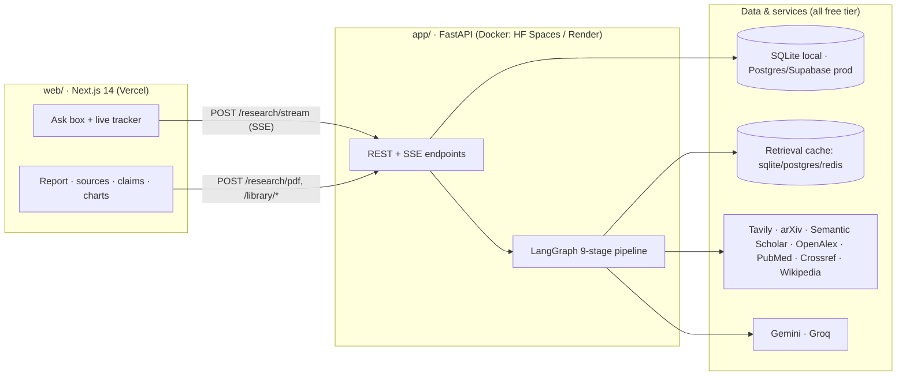
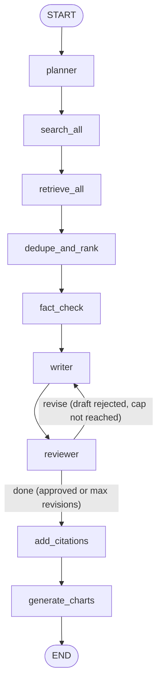

# Architecture — Aurelia Deep Research Studio

This document explains how the system is built and why. For setup and run
commands see [`SETUP_AND_RUN.md`](../SETUP_AND_RUN.md); for using the app see
[`docs/USER_GUIDE.md`](USER_GUIDE.md); for the phase-by-phase build plan see
[`PHASES.md`](../PHASES.md).

---

## The shape of the system

Two independently deployable halves talk over HTTP:

The frontend is **anonymous-first**: it needs only the backend URL to work.
Auth, persistence, storage, rate limiting, and error monitoring are each
independently optional and controlled by environment variables — absent config
means that feature is simply off, never a hard error.

---

## Backend (`app/`)

FastAPI serves the API; the research work itself is a **LangGraph** state machine
built in [`app/graph.py`](../app/graph.py). Nodes are thin wrappers around agents
in [`app/agents/`](../app/agents); shared types live in
[`app/schemas.py`](../app/schemas.py).

### The pipeline

Everything up to `reviewer` is a straight line. The one branch is
`route_after_review`: if the Reviewer rejects the draft and the revision cap
hasn't been hit, control loops back to the Writer with the feedback; otherwise it
proceeds to citations and charts. Each pass through the loop is streamed, so the
frontend shows Writer/Reviewer firing more than once.

| Stage (node) | Agent | Job |
|---|---|---|
| `planner` | PlannerAgent (Gemini) | Decompose the query into sub-questions. |
| `search_all` | SearchAgent (Tavily) + WikipediaAgent | Web results per sub-question. |
| `retrieve_all` | PaperRetrieval + OpenAlex + PubMed + Crossref | Academic sources per sub-question. |
| `dedupe_and_rank` | FAISS + local embeddings | Collapse duplicates, rank by relevance — no API cost. |
| `fact_check` | FactCheckerAgent (Groq/Gemini) | Verdict + confidence per claim; flag contradictions. |
| `writer` | WriterAgent (Gemini) | Draft with inline `[n]` citations from verified claims. |
| `reviewer` | ReviewerAgent (Gemini) | Approve or send back with feedback. |
| `add_citations` | citations.py | Numbered source index + APA/MLA bibliography. |
| `generate_charts` | ChartAgent (Groq/Gemini) | Extract genuinely chartable numeric data. |

### Retrieval sources

Seven sources, all free; every keyless one can be toggled off via config without
touching code (`ENABLE_OPENALEX`, `ENABLE_PUBMED`, `ENABLE_CROSSREF`,
`ENABLE_WIKIPEDIA`):

Web/Tavily (key) and Wikipedia (keyless) feed `search_all`; arXiv, Semantic
Scholar (optional key), OpenAlex, PubMed via Europe PMC, and Crossref feed
`retrieve_all`. Each agent follows the same pattern: cached, retried with
backoff, and failure-tolerant — an outage or rate limit on one source is
recorded in the result's `errors` and the run continues on the rest.

### Model routing ([`app/model_router.py`](../app/model_router.py))

When `LLM_ROUTING_ENABLED` is on and a Groq key is present, "light" stages
(fact-check extraction, chart detection) route to a fast small Groq model, while
"heavy" reasoning (planner, writer, reviewer) stays on Gemini. Every call falls
back to the other provider on failure, so a single provider's outage or quota
doesn't take the pipeline down.

### Resilience: retry, cache, safety net

- **Retry/backoff** ([`app/retry.py`](../app/retry.py)): exponential delay with
  jitter, centralized. Only *retryable* failures are retried — 429s, 5xx, and
  network timeouts. A bad key or an exhausted monthly quota fails fast, because
  retrying can't change the outcome.
- **Cache** ([`app/cache.py`](../app/cache.py)): a TTL cache over the *retrieval*
  agents only (never the LLM reasoning, which must stay fresh for the revision
  loop). Backend is env-driven — `sqlite` (default local file), `postgres` (reuse
  `DATABASE_URL`), or `redis` (`REDIS_URL`) — because host filesystems are
  ephemeral. The factory **fails open**: a broken cache backend degrades to "no
  cache," never to a broken request.
- **Top-level safety net** ([`app/main.py`](../app/main.py)): if something
  genuinely unanticipated breaks mid-graph, `/research` still returns a valid
  response and `/research/stream` still emits a terminal `complete` event with
  whatever partial state exists — the UI is never left hanging.

### Rate limiting ([`app/rate_limit.py`](../app/rate_limit.py))

Off by default (so local dev and tests are unaffected). When enabled, it applies
DB-backed daily quotas keyed by user id (signed-in) or client IP (anonymous),
returns a `429` with `Retry-After` and `X-RateLimit-*` headers when exceeded,
and — like the cache — **fails open** so a counter glitch can't wrongly block a
legitimate request.

### API surface

| Method + path | Purpose |
|---|---|
| `GET /health` | Liveness + which phases are complete. |
| `POST /research` | Run the whole pipeline; return the full result as JSON. |
| `POST /research/stream` | Run the pipeline, streaming one SSE event per stage (what the UI uses). |
| `POST /research/pdf` | Run and return a formatted PDF. |
| `POST /reports/pdf` | Convert an existing result to PDF without re-running. |
| `POST /agents/{search,papers,planner,fact_checker,writer,reviewer}` | Exercise a single agent in isolation (testing/debug). |
| `GET/POST/PATCH/DELETE /library/*` | Saved-library CRUD ([`app/routers/library.py`](../app/routers/library.py)), auth-scoped. |

### SSE streaming contract

`POST /research/stream` returns `text/event-stream`. Each frame is
`data: {json}\n\n` ([`app/stream_events.py`](../app/stream_events.py)). Payloads
carry a `type`:

- `stage` — one per completed node: `{ type, stage, label, summary, errors }`.
- `error` — an unexpected mid-stream failure: `{ type, message }`.
- `complete` — always terminal: `{ type, result }`, where `result` is the full
  research result (report, sources, verified claims, chart specs, errors, and —
  for signed-in users — a `saved_id`).

The frontend mirrors this contract in `web/lib/api.ts` (parser) and
`web/lib/use-research.ts` (reducer → live tracker + report).

---

## Persistence & auth

The saved library is normalized SQLAlchemy models in
[`app/db/`](../app/db) (`research_sessions`, `reports`, `sources`, `claims`,
`charts`, follow-ups, plus Phase-12 usage counters). Locally it's **SQLite** and
tables auto-create on startup — no migration step. In production, point
`DATABASE_URL` at Supabase **Postgres** and apply the Alembic migrations
(`0001_phase11_library`, `0002_phase12_usage_counters`).

Auth is **optional and recognition-only**. With `SUPABASE_JWT_SECRET` set, the
backend verifies bearer tokens (HS256) and attributes saved runs to the user;
without it, everything runs anonymously. **Row-Level Security**
([`supabase/schema.sql`](../supabase/schema.sql)) enforces per-user isolation at
the database, so the frontend never has to filter by user id. Optional Supabase
**Storage** offloads rendered PDFs/chart PNGs to a bucket with signed URLs; left
unconfigured, reports still fully reconstruct from the database.

---

## Frontend (`web/`)

Next.js 14 (App Router) + TypeScript + Tailwind, with hand-authored shadcn/ui
primitives (no component-library dependency to drift).

- **State from the stream.** `lib/api.ts` reads the SSE stream over `fetch`;
  `lib/use-research.ts` turns events into the live stage tracker and the final
  result; `lib/citations.ts` re-implements the backend's source indexing so `[n]`
  markers resolve to the exact source object.
- **UI.** `components/research/*` holds the composer, agent tracker, report view
  (react-markdown + a custom citation renderer), tabbed source cards, claim/
  contradiction badges, and Recharts charts. A cmdk **⌘K palette** lives in
  `components/command/`.
- **Emerald Horizon background** (`components/horizon/`): a Three.js point field
  that reacts to pipeline activity. The heavy `three` bundle is **dynamically
  imported** inside an effect (never during SSR), gated on a WebGL feature check,
  and it honors `prefers-reduced-motion` — falling back to a pure CSS gradient
  when either is unavailable.
- **Auth/library** (`components/auth/`, `app/library/`): present only when the
  `NEXT_PUBLIC_SUPABASE_*` vars are set; otherwise the UI stays in anonymous mode.

Performance: `next/font` for the typefaces, dynamic import for Three.js,
`optimizePackageImports` for the big barrel libraries, and an opt-in
`@next/bundle-analyzer` (`ANALYZE=true npm run build`) — see
[`web/next.config.mjs`](../web/next.config.mjs).

> `frontend/` is the original Vite prototype from the early phases. It's
> superseded by `web/` and kept only for reference.

---

## Testing

**Backend** — pytest, runnable with zero API keys (every external call is faked
in `tests/`). Covers each agent (including cache-hit and retry paths), the graph,
citations, PDF/chart rendering, SSE event shaping, the cache backends, and the
library/status helpers. The safety-net tests inject a crash into a node with no
try/except of its own and confirm both `/research` and `/research/stream` degrade
gracefully.

**Frontend** — Vitest + Testing Library for units/components (`web/tests/unit/`:
citations, `cn`, the horizon store, the SSE client, the `useResearch` reducer,
and the charts panel), and Playwright + axe for end-to-end
(`web/tests/e2e/`). The E2E specs intercept every backend call via
`page.route` (`tests/e2e/mock-backend.ts`), so they run **fully offline** with no
keys and no running API. Test configs isolate test files from the production
build type-check, so a test-only type error can never break `next build`.

**Load sanity** — [`scripts/load_sanity.py`](../scripts/load_sanity.py) fires N
concurrent `/research/stream` requests at a running backend and reports
time-to-first-event, total duration, and how many requests were shed with `429`
(treated as expected graceful degradation on free tiers, not failure).

---

## Configuration & deployment

All configuration is environment-driven ([`app/config.py`](../app/config.py) for
the backend; `NEXT_PUBLIC_*` for the frontend), with safe defaults so the app
runs locally out of the box. Local↔production is a config flip, not a code
change. Free-tier deployment — backend Docker image on Hugging Face Spaces or
Render, frontend on Vercel (root dir `web/`), Supabase Postgres, GitHub Actions
CI, optional keep-warm — is documented in [`DEPLOY.md`](../DEPLOY.md).
